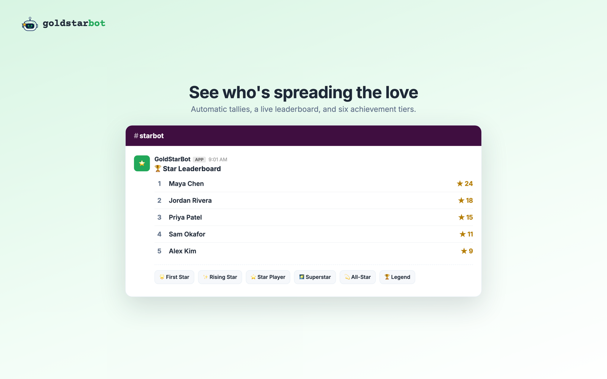

# GoldStarBot

Peer recognition for Slack. Teammates give each other a gold star with `/gs @teammate reason`, and the bot posts it to a recognition channel, keeps a running tally, and awards six achievement tiers.

Live at [goldstarbot.com](https://goldstarbot.com). Flat $19/month, unlimited users.

## What's here

- `goldstar/` is the app: PHP 8.2, Slim 4, PHP-DI, and MySQL. See [goldstar/README.md](goldstar/README.md) for setup and commands.
- `design_handoff_goldstarbot_logo/` holds the logo and brand exports.

## Highlights

- **Multi-tenant Slack app.** Each workspace installs through OAuth v2 and gets its own bot token. Slash commands are verified with Slack's v0 HMAC signature.
- **Stripe billing.** Hosted Checkout, signature-verified webhooks, and the Billing Portal, with a 7-day trial.
- **Two consoles from one codebase.** An operator console (MRR, workspaces, usage chart, audit log) and a customer console scoped to the signed-in team.
- **Safe counting.** Stars and running totals are written in one transaction, so milestone achievements fire exactly once.
- **Runs on shared hosting.** Slack's HTTP request mode instead of Socket Mode, so there's no long-running process to keep alive.

Built by [Derrick Brown](https://resume.dmbweb.com).
